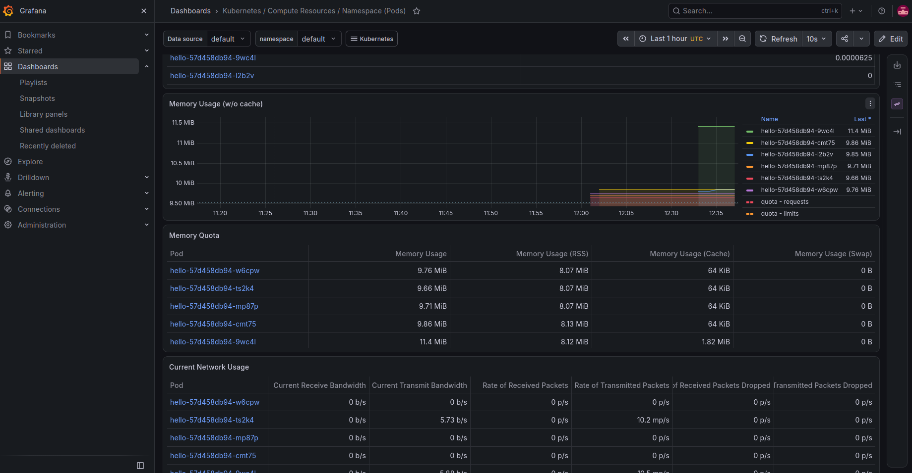
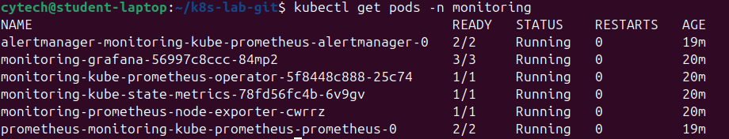

# Lab Kubernetes / GitOps

Petit lab personnel pour découvrir concrètement Kubernetes, Helm, GitOps (Flux) et l'observabilité (Prometheus/Grafana).

## Ce que j'ai fait

1. **Cluster local** avec kind (Kubernetes dans Docker), Kubernetes v1.37.
2. **Déploiement d'une appli** (nginx demo) avec un Deployment et un Service, en manuel avec kubectl : auto-réparation, mise à l'échelle, debug (`describe`, `logs`).
3. **Helm** : création d'un chart, install, upgrade, rollback, uninstall.
4. **GitOps avec Flux** : le dépôt est la source de vérité, Flux applique `clusters/lab/`.
   - Changement du nombre de réplicas via `git push`
   - Dérive corrigée : un Deployment supprimé à la main est recréé par Flux
   - Suppression d'un fichier dans Git : l'appli est retirée du cluster (prune)
5. **Observabilité** : kube-prometheus-stack (Prometheus + Grafana) installé avec Helm, exploration des dashboards et de quelques requêtes PromQL.

## Captures

*Dashboard Grafana : six pods `hello`, déployés par un `git push`.*

*Les composants de la stack de monitoring, tous `Running`.*

## Problèmes rencontrés

- `flux check --pre` refusait le cluster (Kubernetes v1.31, Flux 2.10 exige >= 1.35) : mise à jour de kind et recréation du cluster.
- Flux bloquait le manifest (`namespace not specified`) : correction dans Git avec `namespace: default`.

## Pistes

- Déployer la stack de monitoring via Flux (`HelmRelease`) plutôt qu'avec `helm install`.